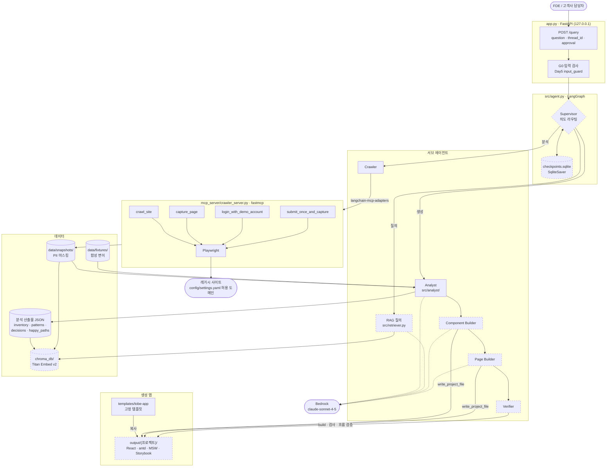
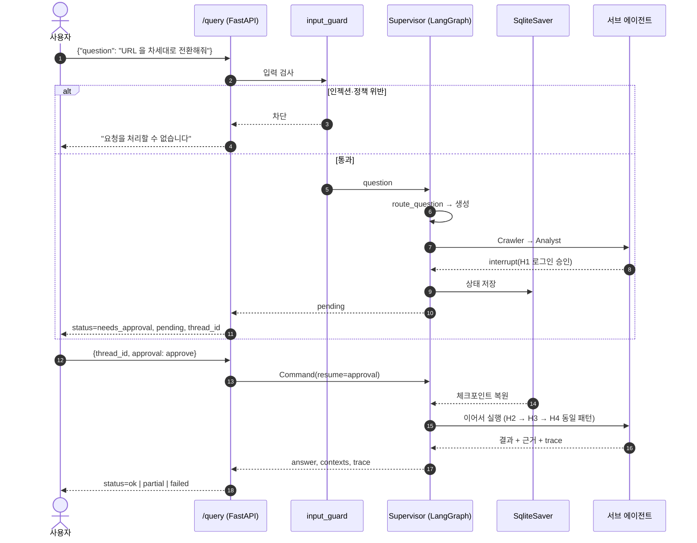
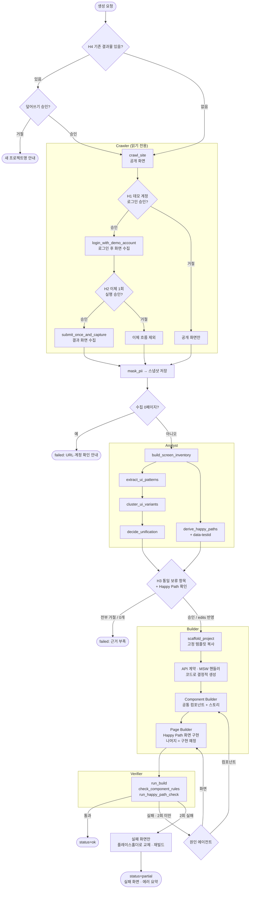
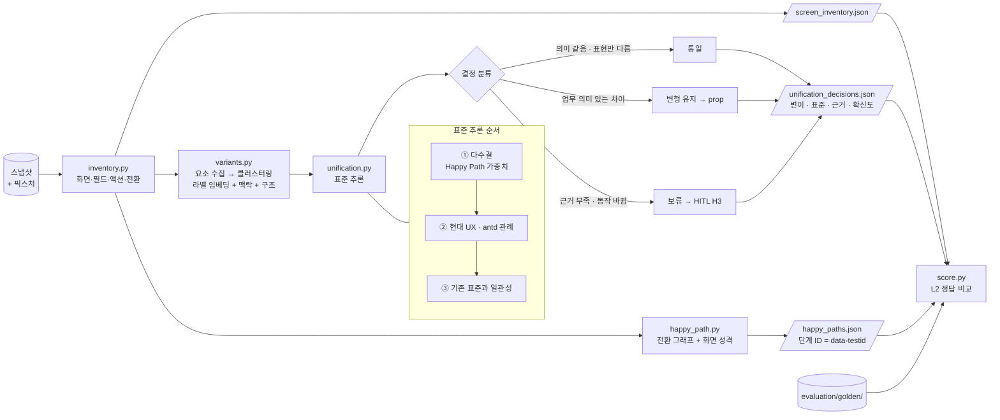
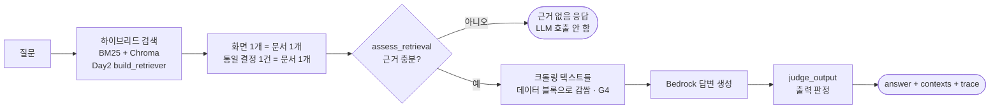
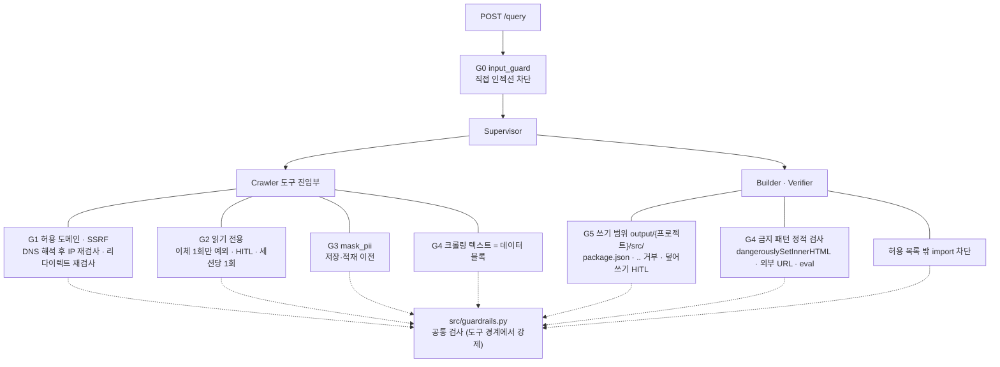
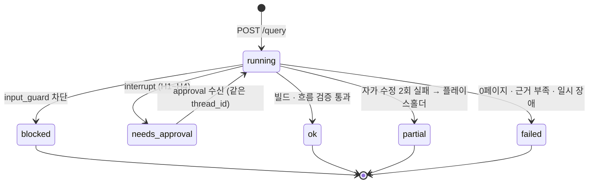

# ARCHITECTURE · Legacy2Next 내부 구조도

`SERVICE.md` §3과 `docs/GUARDRAILS.md`를 그림으로 옮긴 문서입니다. GitHub, VS Code(Markdown Preview Mermaid Support), [mermaid.live](https://mermaid.live)에서 바로 렌더링됩니다.

> 범례: 실선 = 구현 완료(T01~T08), 점선 테두리 = 구현 예정(T09~). 구현 현황은 `tasks/README.md` 기준입니다.

---

## 1. 전체 시스템 구성

---

## 2. 요청 처리와 HITL 이어가기 (시퀀스)

한 번의 생성 요청이 HITL 지점마다 `needs_approval`로 끊기고, 같은 `thread_id` + `approval`로 체크포인트에서 이어집니다.

---

## 3. 생성 파이프라인 (고정 파이프라인 + 자가 수정)

---

## 4. Analyst 내부 (변이 정규화)

---

## 5. 질의응답 (RAG) 경로

---

## 6. 가드레일 강제 지점

---

## 7. 응답 상태 전이

---

## 8. 파일 ↔ 구성 요소 매핑

| 구성 요소 | 파일 | 상태 |
|---|---|---|
| API 진입점 | `app.py` | 스텁 (T11에서 그래프 연결) |
| 설정 (사이트별 값) | `config/settings.yaml`, `src/config.py` | ✅ |
| 가드레일 | `src/guardrails.py`, `src/reuse/day05_guard.py` | ✅ |
| 크롤러 MCP 서버 | `mcp_server/crawler_server.py`, `src/crawler_core.py` | ✅ |
| Analyst | `src/analyst/inventory.py` · `variants.py` · `unification.py` · `happy_path.py` · `score.py` | ✅ (happy_path는 T09) |
| LLM 팩토리 | `src/llm.py` | ✅ |
| Supervisor · HITL | `src/agent.py` | T11 |
| RAG | `src/retriever.py` | T10 |
| 계약 · MSW · Builder · Verifier | `src/codegen/` | T14~T17 |
| 고정 템플릿 | `templates/tobe-app/` | ✅ |
